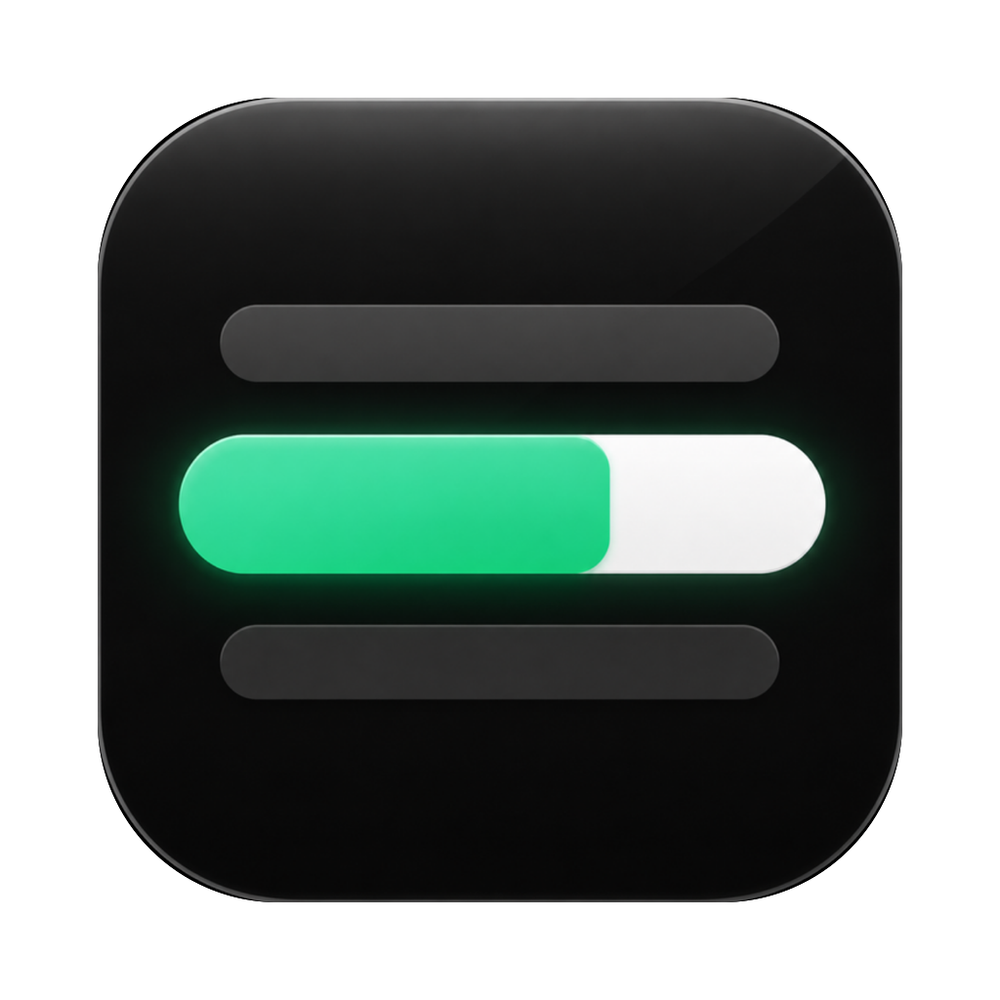

<p align="center">
  
</p>

<h1 align="center">字幕提词器</h1>

<p align="center">把 SRT 字幕变成会跟着时间走的提词器，配音、录口播时照着念就行。</p>

<p align="center">
  <a href="https://github.com/wanghaitao34/subtitle-prompter/releases/latest/download/SubtitlePrompter-1.1.dmg"><b>⬇︎ 下载 macOS 版（1.1）</b></a>
</p>

---

## 它能做什么

- **台词直接变时间码**：只有一份没有时间码的台词也能用。App 会按正常口播的语速估出每句的时长，在逗号、句号、段落之间留出停顿，还能导出成 SRT 字幕。
- **像听歌看歌词一样看字幕**：当前这句居中放大，文字从左到右慢慢变绿，变绿的速度就是这句该念的速度。
- **提前知道要停多久**：两句之间停顿超过 1 秒会出现一根横条，横条越长停得越久。停顿开始后横条慢慢缩短，最后 1 秒变成绿色，提示你该开口了。
- **长句自动分两行**：放不下的句子会在标点或词语之间断开，不会把一个词拆成两半。
- **可以接提词器**：一键镜像，把 iPad 当副屏放在提词器玻璃下面，反射出来的字是正的。
- **纯黑背景**：放在提词器玻璃下面不反光，只看得到字。

## 安装

1. 下载 [字幕提词器 1.1](https://github.com/wanghaitao34/subtitle-prompter/releases/latest/download/SubtitlePrompter-1.1.dmg)。
2. 双击打开下载的 DMG 文件，把「字幕提词器」拖进「应用程序」文件夹。
3. 在「应用程序」里双击打开。第一次打开时，系统会问你「是否要打开从互联网下载的 App」，点「打开」就行。

**系统要求**：macOS 14 或更新版本，Apple 芯片的 Mac（M1 及以后）。

App 已经通过苹果公证，不会出现「无法验证开发者」的警告。

## 使用

### 1. 放入视频和字幕

- 把视频拖进窗口，App 会自动找**同名的 SRT 字幕**。
  比如视频是 `第一课.mp4`，就找同一个文件夹里的 `第一课.srt`；也会去旁边叫「字幕」的文件夹里找（视频放在「XX视频」文件夹时，也会找「XX字幕」文件夹）。
- 没找到字幕时，点右上角的文件夹图标 →「更换字幕…」，手动选一个 SRT 文件。
- 只有字幕、没有视频也可以：直接把 SRT 拖进来，它会按字幕的时间自己往下走。

### 2. 只有台词、没有时间码？

- 把 `.txt` 或 `.md` 台词文件拖进来，或者复制台词后点「**粘贴台词**」（⌘⇧V），App 会自动估出时间码。
- 视频旁边没有同名 SRT、但有同名的 `.txt` / `.md` 台词时，也会自动用台词。
- 估算规则：
  - 每行 8～15 个字，在标点或词语之间断开；「这节课，」「接下来，」这类很短的小句会并到下一句。
  - 默认按**每秒 4.5 个字**算（英文单词每个算 2 个字），每行至少 1.2 秒。
  - 逗号后停 0.2 秒，句号、问号后停 0.5 秒，冒号、分号后停 0.3 秒，段落之间（空行或 `---`）停 1.2 秒；「接下来」「首先」「最后」这类转场词前面再多停 0.3 秒。
  - 想在哪里多停一会儿，就在台词里写 **【停顿】**（1.5 秒）或 **【停顿 3 秒】**。
- 右上角会多出一个「**4.5 字/秒**」菜单：念不完就调低，念完了字幕还没走完就调高，改完立刻重新计算。
- 满意了就点文件夹图标 →「**导出 SRT…**」（⌘S），存成标准字幕文件，剪辑软件可以直接用。

### 3. 播放和跳转

| 操作 | 方法 |
|---|---|
| 播放 / 暂停 | 空格键，或点下方中间的大圆按钮 |
| 上一句 / 下一句 | ← / → 方向键（会提前 1 秒，方便你准备） |
| 跳到某一句 | 直接点那句字幕 |
| 拖动进度 | 拖下方的进度条 |

### 4. 右上角的按钮

- **倍速**：0.5× 到 1.5×，念得慢就调低。
- **喇叭**：静音视频原声，只看字幕自己念。
- **两个「A」**：缩小 / 放大字号。
- **上下箭头**：镜像（上下翻转），给提词器用，快捷键 M。
- **全屏**：快捷键 F。
- **文件夹**：打开视频、更换字幕或台词、粘贴台词、导出 SRT。

字号和镜像设置会自动记住，下次打开不用重新调。

### 5. 放到提词器上用

1. 用 Mac 的「随航」把 iPad 当成第二块屏幕：点菜单栏的「控制中心」→「屏幕镜像」，选你的 iPad。
2. 把字幕提词器的窗口拖到 iPad 上，按 **F** 全屏，再按 **M** 镜像。
3. 把 iPad 平放在提词器底部，屏幕顶部朝外，这样玻璃上看到的字就是正的。
4. 在 Mac 上按空格开始。念错了就按 ←，回到这句开头重来。

## 常见问题

**拖进视频后没有出现字幕？**
说明没找到同名的 SRT 文件。检查字幕文件名和视频是否一样（扩展名除外），或者手动选择字幕。

**玻璃里的字是左右反的？**
说明 iPad 的摆放方向和上面说的不一样，把 iPad 转 180° 再试试。

**支持哪些格式？**
字幕支持 SRT；台词支持 TXT 和 Markdown（加粗、标题等记号会自动去掉）；视频支持 Mac 能直接播放的格式（MP4、MOV 等）。

**估出来的时间准吗？**
是按平均语速估的，适合当节奏参考。实际录完后，最好用真实录音重新听写一份字幕。

---

## 开发者

源码是一个 SwiftUI 文件 `SubtitlePrompter.swift`，只需要 Xcode 命令行工具就能编译：

```bash
./build.sh            # 编译出 字幕提词器.app
./release.sh          # 签名、公证并打包 DMG（需要 Developer ID 证书和公证凭据）
```

- 发布前要在钥匙串里装好「Developer ID Application」证书，并运行一次 `xcrun notarytool store-credentials subtitle-prompter-notary` 存公证凭据。
- 版本号在 `build.sh` 的 `CFBundleShortVersionString` 里改。
- 图标用 Canva 生成，原图和备选方案在 `图标方案/`，用 `swift make_icon.swift 原图.png 图标方案/AppIcon_1024.png` 生成图标底图。
